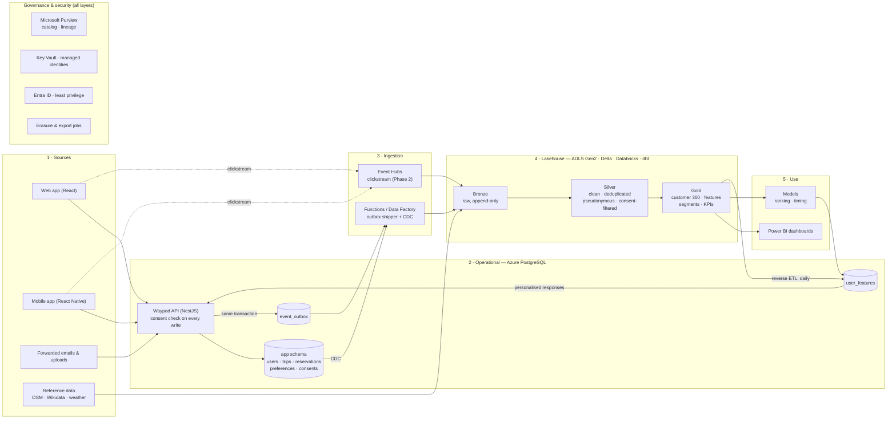
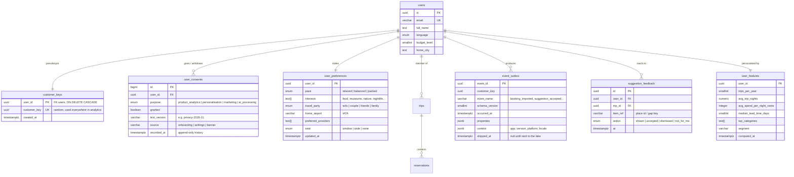
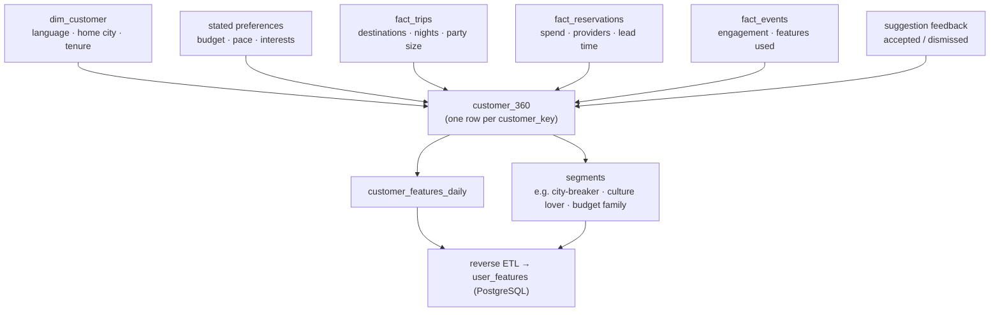
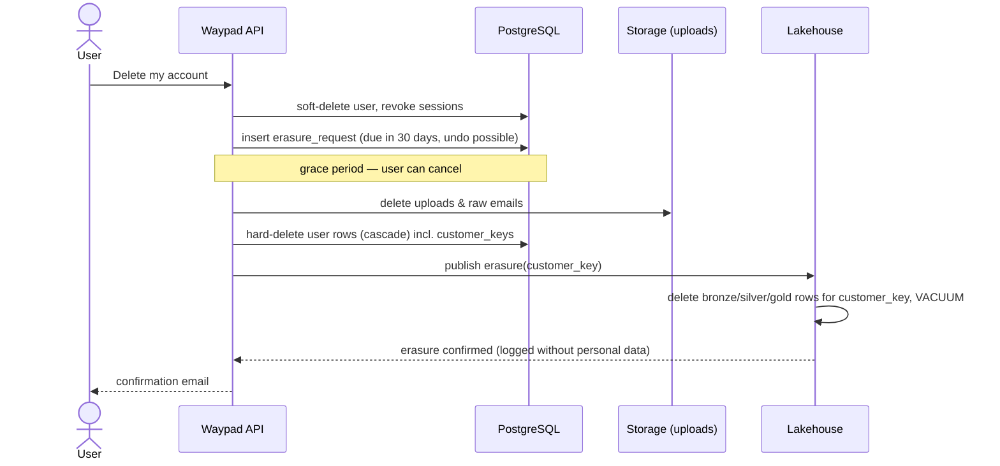

# Data architecture

How Waypad collects, stores and uses customer data to personalise the product — and how it stays lawful, secure and cheap while doing so.

> Status: design (v1.0, 10 Nov 2026). PNG versions of the diagrams (for slides and documents) are in [`docs/diagrams/`](diagrams/). The operational database (PostgreSQL, `apps/api`) exists; everything marked **Phase 1–3** below is planned.

## 1. Goals

1. **One customer view.** Everything Waypad knows about a traveller — profile, stated preferences, trips, bookings, spend, behaviour in the app, feedback on suggestions — joined on one customer key.
2. **Personalisation that improves the product:** better suggestions (fit budget, pace and interests), earlier and more useful reminders, smarter trip matching for imported bookings, audio guides in the right language.
3. **Product analytics:** funnels (sign-up → first import → first trip ready), retention, feature use, import accuracy.
4. **Privacy by design.** Waypad stores a lot of personal data (travel dates, places, bookings, emails). Under the GDPR (Waypad is EU-based) collection needs a lawful basis, a clear purpose and a retention limit. "Keep everything forever" is not allowed — **keep everything the user agreed to, for as long as it is useful, and be able to delete it.** The architecture makes that the default rather than an afterthought.

## 2. Principles

| Principle | What it means in practice |
|---|---|
| Purpose-bound collection | Every data element has a purpose and a lawful basis (contract, consent, legitimate interest). Optional data (behaviour tracking, personalisation, marketing, AI processing) is collected only with consent. |
| Separate operational and analytical data | The app database stays small and fast; analytics and model training run on a copy in the lakehouse. |
| Pseudonymous analytics | The lakehouse never sees names or email addresses — only a `customer_key` (random UUID). The link to the real person lives in one protected table. |
| Erasure by design | Deleting a user removes operational rows and the key mapping ("crypto-shredding"), so lakehouse history can no longer be tied to the person. |
| Immutable raw, curated gold | Raw data (bronze) is append-only and replayable; cleaned (silver) and business-ready (gold) layers are rebuilt from it. |
| Start small | Phase 1 runs on what already exists (PostgreSQL + a storage account). Heavier services are added only when volume requires them. |

## 3. Architecture overview

**Why this shape**

- **Transactional outbox** instead of writing to two systems from the API: an event (e.g. `booking_imported`) is written in the same database transaction as the change, so events are never lost or invented. A small job ships the outbox to the lake.
- **CDC (change data capture)** keeps lake copies of the business tables (trips, reservations) up to date without touching API code.
- **Medallion layers** (bronze → silver → gold) make every number traceable back to the raw record, which matters for audits, GDPR requests and debugging.
- **Reverse ETL to `user_features`**: the API reads personalisation features from its own PostgreSQL with one indexed lookup — no extra service in the request path and no dependency on the lakehouse being up.

## 4. Customer data model

### 4.1 What we store about a customer

| Domain | Examples | Source | Lawful basis | Retention |
|---|---|---|---|---|
| Identity & account | email, name, password hash, language, home city | sign-up, profile | contract | until account deletion |
| Stated preferences | budget level, pace, interests (food, museums, nature…), preferred airlines/hotel chains, seat preference, home airport, travel party (solo, couple, family) | onboarding, settings | contract (user-provided to personalise) | until changed / deleted |
| Trips & bookings | trips, reservations, prices, providers, dates, places | imports, manual entry | contract | until the user deletes them (Waypad is not the seller, so no legal retention duty) |
| Source documents | uploaded PDFs, photos, forwarded emails | upload, email | contract | raw email 30 days; uploads until deleted |
| Behaviour (app events) | screen views, searches, suggestion shown/accepted/dismissed, audio guide plays, import corrections | apps, API | **consent** (product analytics) | raw 13 months, aggregates indefinitely (anonymous) |
| Location | "Near me" position | mobile app | **consent**, used in the moment | not stored; only the city/place chosen |
| Feedback | ratings, "not for me", support messages | apps | contract / legitimate interest | 24 months |
| Derived features | trips per year, typical trip length, spend per night, booking lead time, favourite categories, segment | lakehouse | follows the consent of its inputs | recalculated daily; deleted with the user |
| Consent records | purpose, version of the text, granted/withdrawn, when, from which screen | consent service | legal obligation (proof of consent) | 5 years after withdrawal |

Not collected on purpose: passport and ID numbers, payment card data, health or other special-category data. If a later feature needs one (e.g. accessibility needs), it gets its own explicit consent and encrypted column.

### 4.2 Operational schema additions (PostgreSQL)

Existing tables (users, trips, trip_members, reservations, source_documents, inbound_emails, day_plans, plan_items, places, place_narrations, refresh_tokens) stay as they are. New tables:

Notes
- `user_consents` is **append-only**: the current state is the latest row per purpose, and the history proves what the user agreed to and when.
- `event_outbox.customer_key` — events carry the pseudonym, never the email.
- `user_features` is written only by the reverse-ETL job and is safe to drop and rebuild.

### 4.3 Event tracking plan

Events follow `object_action` naming, a versioned schema, and are validated (zod on the API, JSON Schema in the lake). Only sent when the `product_analytics` consent is granted; `personalisation` must be granted for events to feed the user's own features.

| Event | Key properties | Used for |
|---|---|---|
| `account_created` | language, signup_source | funnel |
| `onboarding_completed` | interests_count, pace, budget_level | preference coverage |
| `trip_created` | city, nights, travelers, days_until_start | lead time, destinations |
| `booking_imported` | type, source (pdf/email/photo), reader (claude/rules), fields_flagged | import accuracy |
| `booking_field_corrected` | type, field, reader | reader quality, retraining |
| `booking_confirmed` | type, minutes_since_import | review friction |
| `gap_shown` / `gap_resolved` | kind, days_before_trip | readiness KPI |
| `suggestion_shown` / `suggestion_accepted` / `suggestion_dismissed` | section, place_category, price_level, rank_position | ranking model labels |
| `audio_guide_played` | place, language, seconds_listened, fallback | content priorities |
| `reminder_sent` / `reminder_opened` | kind (check-in, free cancellation) | timing |
| `search_performed` | screen, query_length, results | missing content |

Common context on every event: `event_id`, `customer_key`, `session_id`, `occurred_at` (UTC), `app` (web/ios/android/api), `app_version`, `locale`, `consent_version`.

## 5. Lakehouse layers

| Layer | Contents | Format & rules |
|---|---|---|
| **Bronze** | Raw outbox events, CDC of `trips`, `reservations`, `user_preferences`, `user_consents`; Event Hubs clickstream; reference data | Delta tables, append-only, partitioned by ingest date; schema stored, nothing deleted except by erasure jobs |
| **Silver** | Typed, deduplicated (`event_id`), late events handled, time zones normalised; `fact_events`, `dim_customer` (pseudonymous, SCD type 2), `fact_reservations`, `fact_trips`, `dim_place`, `dim_city` | dbt models with tests (unique, not null, accepted values, freshness); rows of users without the needed consent are filtered here |
| **Gold** | `customer_360`, `customer_features_daily`, `segments`, KPI marts (funnel, retention, import accuracy, suggestion CTR) | business-ready, documented, feeds Power BI, models and reverse ETL |

### 5.1 Customer 360 (gold)

### 5.2 How personalisation uses it

| Product moment | Features used | Effect |
|---|---|---|
| Suggestions ("Fill your free time") | budget level, interests, pace, top categories, past accept/dismiss | ranking and number of picks per window |
| Trip matching for imports | typical trip length, home airport | better guess of which trip a booking belongs to |
| Reminders | median lead time, reminder open rate by hour | when to remind about check-in or free cancellation |
| Audio guide | language, listen-through rate | language default, which places get narration next |
| Dashboard | segment, engagement | which empty-state and tips to show |

Phase 1 uses rules on these features (transparent and testable, like `src/guide/suggest.ts`). Phase 3 adds a learned ranking model trained on `suggestion_*` events, evaluated offline before an A/B test.

## 6. Privacy, consent and security

### 6.1 Consent flow

1. Onboarding shows clear choices: **personalised suggestions**, **product analytics**, **AI reading of my documents**, **news and tips (marketing)**. Off by default except what the service needs to work.
2. The API records each choice in `user_consents` and exposes `GET/PUT /me/consents`.
3. Event tracking checks consent before writing to the outbox; the silver layer filters again (defence in depth).
4. Withdrawing consent stops new collection immediately and removes the user's features at the next daily run.

### 6.2 Right of access and erasure

**Access / export** (`GET /me/export`): one ZIP with profile, preferences, consents, trips, reservations and source documents as JSON + originals.

### 6.3 Security controls

| Area | Control |
|---|---|
| Access | Entra ID groups; least privilege per layer (engineers read silver/gold, only the platform identity writes bronze); no personal data in dev — synthetic or pseudonymised copies |
| Encryption | TLS everywhere; encryption at rest (Azure-managed keys, customer-managed in Key Vault later); sensitive columns (e.g. future accessibility data) encrypted at application level |
| Pseudonymisation | `customer_key` in all analytics; email/name only in PostgreSQL; free text (email bodies) never leaves bronze and is purged with the raw mail |
| Region | All data in EU regions (West Europe / North Europe); AI provider used under a data-processing agreement, no training on customer data |
| Audit | Purview lineage, Databricks/Unity Catalog audit logs, PostgreSQL audit of admin access |
| DPIA | Data Protection Impact Assessment before launching location and behavioural personalisation |

## 7. Data quality and operations

- **Contracts:** event schemas versioned in the repo; breaking changes need a new `schema_version`.
- **Tests:** dbt tests on every silver/gold model; row-count and freshness checks; anomaly alerts (e.g. import accuracy drops after a reader change).
- **SLAs:** gold refreshed daily by 06:00 CET; `user_features` refreshed after gold; dashboards show "data as of".
- **Lineage & catalog:** Purview scans PostgreSQL, ADLS and Databricks; every gold table has an owner and a description.
- **Cost guardrails:** serverless/job clusters with auto-stop, Event Hubs only when clickstream volume justifies it, budget alerts.

## 8. Technology choices (Azure)

| Need | Phase 1 (now) | Phase 2 (growth) | Alternative |
|---|---|---|---|
| Operational DB | Azure Database for PostgreSQL Flexible Server | + read replica for exports | — |
| Event capture | `event_outbox` table + scheduled shipper | + Azure Event Hubs for clickstream | Kafka (Confluent) |
| Ingestion / CDC | Azure Function (timer) → Parquet in ADLS | Data Factory / Debezium CDC | Fivetran / Airbyte |
| Storage | ADLS Gen2 (Delta) | same | Microsoft Fabric OneLake |
| Processing | Databricks SQL warehouse (small) or DuckDB jobs | Databricks jobs + Unity Catalog | Fabric Lakehouse / Synapse |
| Transformations | dbt Core | dbt + CI tests | — |
| BI | Power BI | Power BI with row-level security | Metabase |
| Governance | Purview (free tier scans) | Purview + Unity Catalog | — |
| Secrets | Key Vault | Key Vault + managed identities | — |

## 9. Roadmap

| Phase | Scope | Outcome |
|---|---|---|
| **1 — Foundation** (2–3 weeks) | `customer_keys`, `user_consents`, `user_preferences`, `event_outbox`, `suggestion_feedback`, consent + preferences endpoints, onboarding screen, tracking of the 10 core events, nightly ship to ADLS, first silver/gold models in dbt, funnel dashboard | first customer 360 and KPIs, consent-proof |
| **2 — Personalisation** (3–4 weeks) | `customer_features_daily`, reverse ETL to `user_features`, suggestions and reminders use features, export + erasure flows end to end, Purview | visibly personal suggestions, GDPR requests automated |
| **3 — Learning** | clickstream via Event Hubs, ranking model on suggestion feedback, A/B testing, reader-quality loop from field corrections | measurable lift in suggestion acceptance and import accuracy |

## 10. KPIs this architecture makes possible

- Activation: % of sign-ups with a first imported booking within 7 days
- Readiness: % of trips 4/4 ready 7 days before departure
- Import accuracy: % of imported fields not corrected by the user, per reader and booking type
- Suggestion acceptance rate per section and segment
- 30/90-day retention, trips per active user per year

## 11. Implementation status

**Phase 1 — dbt (done):** `data/dbt` builds silver and gold from the bronze files (customer 360, personalisation features, funnel, import accuracy, suggestion KPIs) with 48 tests, on DuckDB locally and in CI. See [data/README.md](../data/README.md). The API part (tables, consents, tracking, lake export) is in its own pull request.
